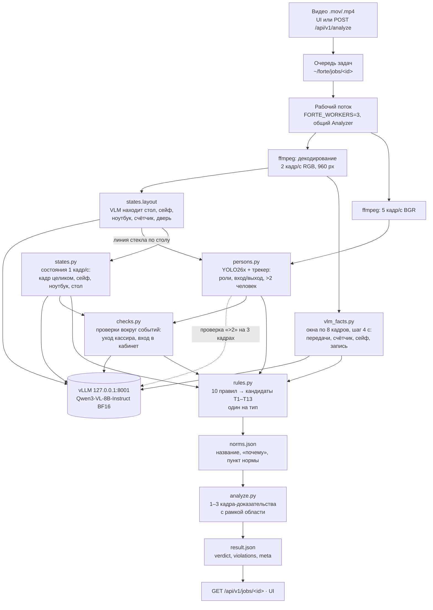

# Архитектура

Коротко: детектор людей и локальная мультимодальная модель (VLM) только **описывают** видео — кто где, что лежит на столе, открыт ли сейф, кто кому что передал. Решение «нарушение / нет» принимают явные правила в `pipeline/rules.py`. Каждое правило привязано к типу нарушения и пункту нормы в `pipeline/norms.json` (см. [NORMS.md](NORMS.md), [TYPES.md](TYPES.md)).

## Схема обработки

Порядок этапов в `Analyzer.analyze` (`pipeline/analyze.py`):

1. декодирование;
2. раскладка сцены (VLM): трекер людей ждёт её, чтобы поставить линию стекла по столу, состояния — чтобы взять вырезы;
3. параллельно в одном `ThreadPoolExecutor`: люди, состояния, факты (факты от раскладки не зависят и стартуют сразу);
4. проверки событий по найденным уходам кассира и входам в кабинет;
5. правила, нормы, кадры‑доказательства.

Запросы к VLM от всех этапов и задач собираются на одном сервере vLLM, который пакетирует их сам.

## Этапы и модели

### 1. Декодирование — `pipeline/video.py`

ffmpeg с учётом поворота из метаданных. Кадры уменьшаются до 960 px по длинной стороне. Для состояний берётся каждый второй кадр (1 кадр/с); если кадров больше 200, шаг увеличивается (`MAX_STATE_FRAMES` в `analyze.py`). Кадр k лежит на k/fps секунде, поэтому таймкоды правил совпадают со временем видео.

### 2. Люди — `pipeline/persons.py`, YOLO26x

- **Детектор:** YOLO26x (Ultralytics), 640 px, уверенность от 0.25, подавление дублей (перекрытие ≥ 70 % меньшей рамки).
- **Почему YOLO26x.** На 45 кадрах с ручным эталоном (65 человек) он нашёл всех без лишних рамок в комнате, у него самый стабильный счёт среди 14 детекторов (4.9 скачка на 100 кадров) и 11.5 мс/кадр на L40S. С фильтрами при пороге 0.5 нет ни одной ложной тревоги «больше двух человек» на 39 роликах, а тревога в X‑18 есть. RT‑DETRv2 и D‑FINE давали в 7–20 раз больше ложных «>2».
- **Трекер:** IoU и расстояние центров, венгерский алгоритм (scipy), склейка фрагментов одного человека.
- **Классы рамок:** в комнате, за стеклом, отражение. Решает линия стекла: низ рамки выше линии — человек снаружи или отражение. По умолчанию линия стоит на 340/848 высоты кадра (камера открытого набора); если VLM нашла стол выше, линия поднимается к верхнему краю стола минус 2 % высоты кадра (`Analyzer._persons`, `PersonTracker.run(glass_frac=…)`). На 42 открытых роликах это ничего не меняет, а на смоделированных наклонённых и приближенных ракурсах возвращает события трекера (см. «Устойчивость к другому ракурсу»).
- **Роли и события:** кассир — самый долгий трек в комнате, остальные — посетители. События: кассир встал, вышел, вернулся; посетитель вошёл, вышел; начало и конец толпы.
- **Толпа (>2 человек ≥ 1 с):** каждый кандидат проверяется VLM на трёх кадрах вопросом «сколько людей физически в комнате, без отражений и людей за стеклом».
- Лица не распознаются и не сравниваются (FAQ 29): используются только рамки и их геометрия.

### 3. Состояния сцены — `pipeline/states.py`, Qwen3‑VL‑8B

- **Раскладка:** модель на 5 кадрах находит стол, сейф, ноутбук, счётчик банкнот и дверь; берутся медианы рамок. Пиксельных координат в коде нет, поэтому на другом ракурсе рамки просто сдвинутся. Раскладка считается первой: её используют трекер, состояния, проверки событий и кадры‑доказательства.
- **Состояния (1 кадр/с):** на каждый кадр — четыре маленьких запроса, у каждого одна картинка и один узкий вопрос:
  - кадр целиком: сколько людей в комнате, поза кассира (сидит / стоит / нет), дверь;
  - вырез сейфа: открыт ли, ключ в замке;
  - вырез ноутбука: рабочее окно, картинка или экран блокировки, выключен, закрыт;
  - вырез стола: деньги, сумка, тетрадь или папка, удостоверение, одежда, чашка или еда.
- **Почему вырезы.** На опорных кадрах узкие запросы по вырезу дали ответы точнее, чем один запрос со всеми полями по целому кадру (`pipeline/probe_states.py`).

### 4. Факты операции — `pipeline/vlm_facts.py`, Qwen3‑VL‑8B

По отдельным кадрам не понять, кто кому что передал и в каком порядке. Поэтому модель смотрит окно из 8 последовательных кадров (2 кадр/с, окно 8 с, шаг 4 с, номер в углу каждого кадра) и для каждого события называет номер первого кадра, где оно видно, или 0. События сгруппированы в три запроса на окно: передачи (посетитель → кассир, просмотр карточки, купюры обратно посетителю); счёт (снята резинка, купюры в счётчик, детектор подлинности, отбракованные в общую стопку, ручной пересчёт); сейф и запись (вскрытие сумки, деньги в сейф, запись в тетрадь, набор на ноутбуке). Факт засчитывается по визиту, если его видели минимум 2 перекрывающихся окна. Номер кадра оказался наименее склонным к ответу «да» форматом вопроса: вопросы «да/нет» на чистых роликах тянули модель к «да» (docstring модуля).

Замер на 42 роликах: надёжно видны передачи от посетителя (16/16 роликов с передачей, 3/22 ложных), пересчёт на счётчике (22/23), деньги в сейф (8/9, 2/26 ложных), запись (7/7), вскрытие сумки (2/2). Ненадёжно: отличить удостоверение от пачки денег на одном кадре (10/26 ложных), детектор подлинности (0/3), смешивание отбракованных купюр (0/2).

### 5. Проверки вокруг событий — `pipeline/checks.py`, Qwen3‑VL‑8B и сравнение пикселей

Вопросы по отдельным кадрам пропускают мелкое и неоднозначное: тетрадь или сумку на столе, ключ, который забирают из сейфа, закрытую стеклянную дверь. Поэтому вокруг каждого ухода кассира и каждого входа в кабинет (до 4 входов на видео) задаются отдельные вопросы:

- **уход кассира** (`leave_check`): пустой кабинет через несколько секунд после выхода — по одному узкому вопросу на каждый предмет по вырезу стола; экран ноутбука до и после; забрала ли кассир ключ из сейфа — по пронумерованной последовательности вырезов сейфа; остался ли ключ в замке — без VLM, пиксельным признаком `key_left_check`: шнурок ключа под замочной скважиной (тёмная полоска на дверце) виден, пока кассир работает, и остаётся после её выхода (Qwen3‑VL‑8B ключ на этом разрешении не видит, см. [TYPES.md](TYPES.md#t5--ключ-в-замке-сейфа-rule_key_left-пиксельный-признак-key_left_check));
- **вход в кабинет** (`entry_check`): состояние двери VLM **не** спрашивается — на этой камере Qwen3‑VL‑8B отвечает «открыта» для закрытой стеклянной двери. Вырез двери сравнивается по пикселям с эталонным кадром до входа, когда дверь была закрыта: дверь считается снова закрытой, когда разница возвращается к уровню эталона и держится. Вошёл ли или смотрит ли в проём кто‑то ещё, спрашивается у VLM по последовательности кадров.

Результаты попадают в `Signals.checks` и используются правилами T3, T6, T7 (вместе с состояниями: хватает любого из двух сигналов), T5 (только признак ключа) и T8 (основной сигнал; по docstring `rule_door_open` — 12 из 12 открытых роликов).

### 6. Почему VLM не выносит вердикт

Zero‑shot ни одна VLM не отличила окна с нарушением от чистых. Qwen3‑VL‑8B сказала «нарушение» в 11 из 22 окон с нарушением и в 11 из 19 чистых, Qwen3‑VL‑4B — в 9/22 и 9/19, остальные почти всегда отвечали «нет». Модели повторяли правила из промпта независимо от кадров: Qwen3‑VL‑8B писала «сейф не закрыт» в 11 из 19 чистых окон. Поэтому:

- в промптах нет правил и слова «нарушение» — только описание видимого;
- ответы ограничены JSON‑схемой (structured output vLLM, `response_format: json_schema`) с закрытыми перечнями значений: их можно разобрать и сохранить без интерпретации свободного текста;
- `temperature` = 0, на каждый запрос до 3 попыток (`pipeline/vlm.py`);
- Qwen3‑VL‑8B выбрана среди пяти проверенных VLM (Qwen3‑VL‑2B/4B/8B, Qwen2.5‑VL‑7B, InternVL3.5‑8B): её описания наиболее конкретны, в BF16 она занимает 16.6 ГБ.

### 7. Правила — `pipeline/rules.py`

10 функций‑правил получают сигналы (`Signals`: состояния, люди, факты, проверки событий) и возвращают кандидатов `{type_id, t, conf, observation, evidence_t, region}`. На каждый тип остаётся один кандидат с наибольшей уверенностью. Все пороги собраны в словаре `PARAMS` и подобраны на 42 открытых роликах. Сигналы сохраняются в JSON, поэтому правила проверяются без GPU за секунды (`pipeline/offline.py`).

Почему явные правила, а не обученный классификатор:
- 42 ролика (25 с нарушениями) мало для обучения классификатора типов; правило проверяется и правится на каждом ролике;
- каждое правило соответствует одному типу и одному пункту нормы: описание строится из того, что видно (`observation`), и обоснования из `norms.json` (`why`, всегда «может указывать»);
- для нарушений «по бездействию» правило формулирует только отсутствие видимого действия: «не видно, чтобы…» (раздел 7 ТЗ).

Список правил, сигналов и таймкодов — в [TYPES.md](TYPES.md).

### 8. Результат — `pipeline/analyze.py`

Для каждого кандидата: название, описание и норма из `norms.json`, 1–3 кадра (таймкод события и до двух моментов из `evidence_t`, не ближе 1 с друг к другу), извлечённые ffmpeg точно по времени. На кадре обведена область (стол, сейф, ноутбук, дверь или люди в комнате) и подписан таймкод. Сигналы задачи сохраняются в `~/forte/jobs/<id>/signals.json` для разбора.

## Устройство сервиса — `service/app.py`

- **FastAPI + uvicorn** на `127.0.0.1:8000` (systemd `forte-api.service`). Веб‑интерфейс — статический HTML/JS/CSS без сборки (`service/static/`).
- **Очередь:** `queue.Queue` и `FORTE_WORKERS` рабочих потоков (по умолчанию 2). Все потоки делят один экземпляр `Analyzer`: YOLO26x загружается в память один раз, запросы к VLM идут на общий сервер vLLM.
- **Загрузка моделей** идёт в фоне после старта; задачи, принятые до её окончания, ждут. Если загрузка упала, API продолжает работать, а задачи завершаются `failed` с причиной.
- **Хранение задач:** `~/forte/jobs/<id>/` — `input.mov`, `status.json` (атомарная запись через временный файл), `result.json`. После перезапуска сервиса готовые задачи доступны, а незавершённые снова встают в очередь в порядке поступления.
- **Проверка загрузки:** расширение .mov/.mp4, лимит размера (`FORTE_MAX_UPLOAD_MB`, 200 МБ), ffprobe должен прочитать видеопоток, а ffmpeg — декодировать кадр в начале и в середине видео; иначе 400 сразу, а не ошибка через минуту.
- **API‑ключ:** заголовок `X-API-Key`, сравнение за постоянное время (`hmac.compare_digest`). Ключ генерируется при первом запуске (`secrets.token_urlsafe(32)`) в `~/forte/service/api_key.txt` с правами 600. UI работает без ключа через отдельные маршруты `/ui/*` (FAQ 27).
- **Публичный адрес:** обратный прокси Caddy на самом хосте (`forte-proxy.service`, `service/deploy/Caddyfile`): `https://216-81-248-201.sslip.io` с сертификатом Let's Encrypt и `http://216.81.248.201`. Резерв — Cloudflare quick tunnel (`forte-tunnel.service`, `service/deploy/tunnel.sh`). Наружу открыты только порты 80 и 443 прокси, порты 8000 и 8001 слушают 127.0.0.1. Туннель и прокси только передают загружаемое видео в сервис; обработка идёт на хосте, кадры и описания никуда не отправляются.

## Локальность

Все модели работают на GPU‑хосте команды; во время обработки видео нет обращений к внешним сервисам (раздел 7 ТЗ):

- Qwen3‑VL‑8B — локальный сервер vLLM на `127.0.0.1:8001`, веса из `~/hf`; флаги `HF_HUB_OFFLINE=1`, `TRANSFORMERS_OFFLINE=1`, сбор статистики vLLM выключен (`VLLM_NO_USAGE_STATS=1`, `DO_NOT_TRACK=1`, `VLLM_DO_NOT_TRACK=1`) — `tools/vllm_serve.sh`;
- YOLO26x — файл `~/det_weights/yolo26x.pt`; `YOLO_OFFLINE=1`, `YOLO_AUTOINSTALL=0`, отправка аналитики Ultralytics выключена (`settings.update({"sync": False})` в `pipeline/persons.py`);
- клиент VLM (`pipeline/vlm.py`) по умолчанию ходит только на `http://127.0.0.1:8001/v1`;
- декодирование — локальный ffmpeg.

Интернет нужен только при установке (пакеты, веса, см. [README.md](README.md#установка-на-новый-gpu-хост)) и чтобы жюри могло открыть публичный адрес. Во внутреннем контуре банка тот же сервис публикует штатный обратный прокси.

## Время обработки

Полный прогон `Analyzer` на всех 42 открытых роликах: `pipeline.batch --threads 2` (две задачи одновременно, все этапы, включая проверки событий), общий сервер vLLM на L40S (`~/forte/logs/batch_final.log`, 18.10.2026, код на 09:00):

| Показатель | Значение |
|---|---|
| Весь прогон | 682 с на 42 ролика (≈ 1 447 с видео) |
| Время на ролик, медиана | 25.7 с |
| Время на ролик, минимум / максимум | 18.4 с (X‑20, 12 с видео) / 82.9 с (X‑14, 143 с видео) |
| Ролики дольше 60 с обработки | X‑05 (72 с видео) 63.7 с, X‑14 (143 с) 82.9 с |
| Обработка / длительность видео | медиана 1.07; у роликов от 57 с — 0.58–0.88, у роликов 12–21 с — до 1.68 (X‑15): раскладка и проверки событий занимают время независимо от длины ролика |

Время этапов на ролике X‑14 (143 с): состояния 80.8 с, факты 30.6 с, люди 28.0 с, раскладка 15.1 с, проверки 0 с (уходов и входов нет). Раскладка идёт первой, затем параллельно люди, состояния и факты, поэтому сумма этапов больше общего времени; общее время определяют состояния плюс проверки событий, которые идут после них (0–6.1 с на открытых роликах).

**Нагрузка как у жюри** (`tools/jury_sim.sh`: одновременная загрузка через публичный адрес, `FORTE_WORKERS=3`, 18.10.2026, 08:45): 6 роликов сразу (X‑14 143 с, X‑39 79 с, X‑05 72 с, X‑20, X‑33, X‑17) — все результаты получены за 231 с от загрузки, обработка на сервере до 86.4 с на ролик, ожидания в очереди не было. С двумя рабочими потоками тот же тест давал ожидание в очереди 21 с для шестого ролика.

Одиночные задачи через сервис (`~/forte/jobs/*/status.json`, поле `processing_sec`): X‑33 (14.3 с видео) — 13.7 с на свободном сервере; X‑28 (16.5 с) — 62.5 с, когда на том же GPU шёл пакетный прогон. Время одной задачи сильно зависит от параллельной нагрузки на сервер vLLM.

- Самый длинный ролик открытого набора (143 с, максимум по FAQ — 145 с) обработан за 82.9 с в пакетном прогоне и за 84.3 с при шести одновременных загрузках через публичный адрес; лимит — 5 минут.
- В API к времени обработки добавляется ожидание в очереди (`queue_position`).
- Фактическое время каждой задачи и её этапов (`layout`, `persons`, `facts`, `states`, `checks`) возвращается в `meta.processing_sec` и `meta.stage_sec`.

## Устойчивость к другому ракурсу

FAQ 4: финальное видео снимут под другим углом. Проверка (скрипты `analysis/robust/make_aug.py` и `analysis/robust/score.py`): 11 открытых роликов (8 с нарушениями T9, T3, T6, T4, T8, T1, T2, T11 и 3 чистых), каждый в 6 смоделированных ракурсах — перспектива (камера сдвинута на 15–20°), поворот на 8°, приближение до 80 %, зеркальное отражение, темнее и размытее, альбомный кадр с полями. Всего 66 роликов, полный `Analyzer`.

- Верный вердикт — 59 из 66, нарушение найдено в 46 из 48 роликов с нарушением.
- Устойчивы при всех ракурсах: T9, T3, T6, T8 и таймкоды «оставил при уходе»; чистые X‑23 и X‑29 чистые везде.
- Слабые места: T4 (вопрос о сейфе на маленьком вырезе) теряется при отражении, затемнении и альбомном кадре; T1, T2, T11 зависят от фактов VLM, которые меняются от рендера к рендеру; чистый X‑05 даёт ложную тревогу на нескольких рендерах (T1 или T8). Часть различий — разброс ответов vLLM под нагрузкой: повторный прогон тех же роликов давал другие ответы на отдельных клипах.

По итогам в код внесены четыре исправления. Каждое проверено на сохранённых сигналах 42 открытых роликов: результат не меняется.

1. Линия стекла поднимается к столу, найденному VLM (`Analyzer._persons`, `PersonTracker.run(glass_frac=…)`): на повороте и приближении трекер снова видит уход кассира и третьего человека.
2. T8: если вырез двери ни разу не изменился после входа, проверка считается неопределённой и тревоги нет; кроме того, установившаяся разница с эталоном закрытой двери должна быть не меньше 28 (`door_open_diff` в `PARAMS`).
3. T4: допускается мерцание ответов в конце ролика — от первого кадра с открытым сейфом он открыт на ≥ 60 % кадров и на ≥ 3 из последних 5 (`rule_safe_open`).
4. T2 и T11 учитывают «деньги в сейф» из фактов, только если в пределах ±3 с VLM видит открытый сейф (`_confirmed_deposits` в `pipeline/rules.py`).

Ограничения проверки: смоделированные ракурсы сохраняют ту же комнату, людей и свет; реальный новый угол меняет и перекрытия (сейф за кассиром, дверь вне кадра). Прогон с исправлениями на 66 роликах в отчёте не приводится.

## Развитие

- **Детектор объектов.** Деньги, сумку, папку, ключ в замке, состояние сейфа и двери можно дообучить на авторазметке (YOLO26x/RF‑DETR‑M), чтобы мелкие объекты не зависели от VLM. Обученные веса `~/forte/weights/forte_det.pt` уже лежат на хосте, но в конвейер не подключены.
- **Другие ракурсы.** Заменить линию стекла классами «за стеклом / отражение» в детекторе; брать вырезы сейфа и стола из кадра полного разрешения на широкоугольной камере; проверять качество по позициям камеры (leave‑one‑cluster‑out).
- **Новые типы.** Тип добавляется функцией в `RULES` и записью в `norms.json`; `GENERIC` уже есть в реестре для отклонений вне T1–T13 (FAQ 9).
- **LoRA для Qwen3‑VL‑8B** на окнах с разметкой команды — если появится больше размеченных видео.
- **Масштабирование.** Сервер vLLM можно вынести на отдельный GPU и подключить к нему несколько экземпляров API (`FORTE_VLLM_URL`).
